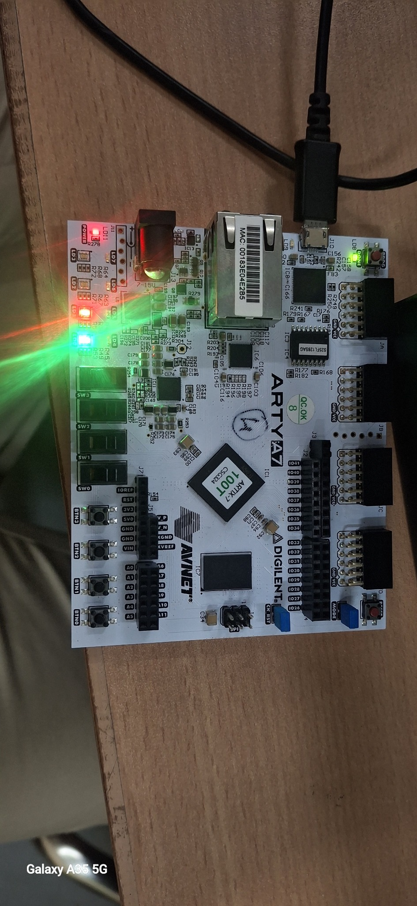
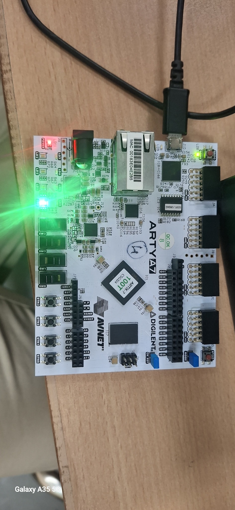
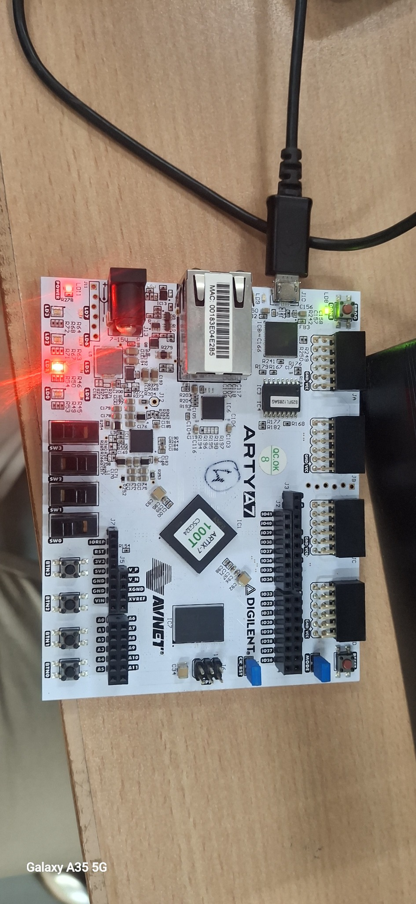
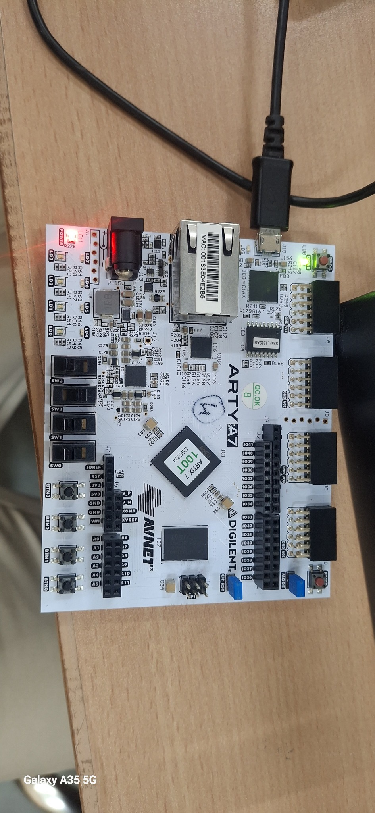
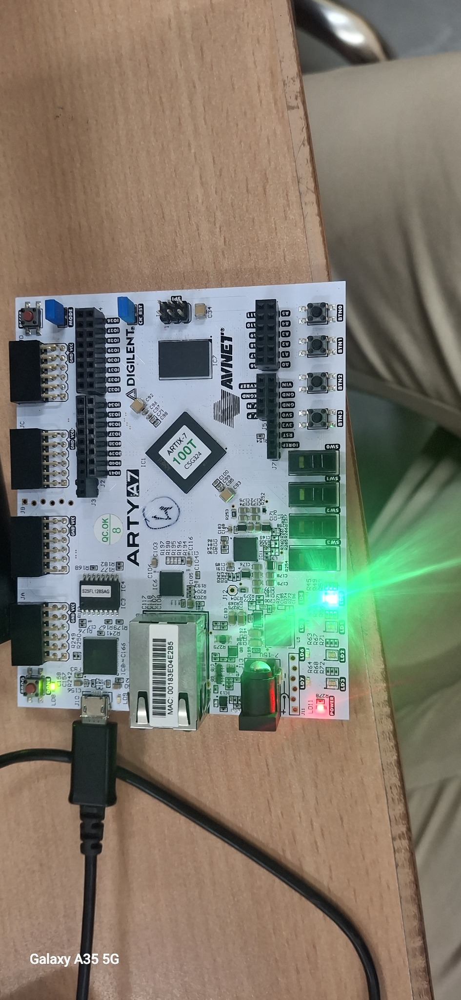

# DDR3L Memory Controller with Integrated SECDED ECC

A complete FPGA implementation of a DDR3L memory interface with a 64-bit data path protected by 72-bit SECDED (single-error correction, double-error detection) coding. The hardware target is the **Digilent Arty A7-100T** with an **Artix-7 XC7A100T (`xc7a100tcsg324-1`)**, implemented using **AMD/Xilinx Vivado 2025.2** and the **7-Series Memory Interface Generator (MIG)**.

> **Project status:** RTL/behavioral verification, MIG integration, Vivado synthesis, implementation, bitstream generation, FPGA programming, DDR calibration indication, and the board LED integration demonstration have been completed/reported working. The remaining DRC warning and the limits of the available hardware evidence are documented below.

## Contents

- [Project overview](#project-overview)
- [Architecture](#architecture)
- [SECDED storage format](#secded-storage-format)
- [Repository layout](#repository-layout)
- [Behavioral verification](#behavioral-verification)
- [Vivado 2025.2 build flow](#vivado-20252-build-flow)
- [Physical board setup and LED operation](#physical-board-setup-and-led-operation)
- [Physical DDR/ECC diagnostic sequence](#physical-ddrecc-diagnostic-sequence)
- [Implementation results](#implementation-results)
- [Known DRC warning and evidence limitations](#known-drc-warning-and-evidence-limitations)
- [Release files](#release-files)
- [Reproducing the project](#reproducing-the-project)

## Project overview

The design connects custom SECDED logic and an AXI master to the user-side AXI interface of the Xilinx MIG 7-Series IP. MIG implements the DDR3L controller and PHY for the board's physical x16 DDR3L device. The ECC logic protects each 64-bit payload with a 72-bit codeword.

The repository also contains a simplified, behavioral DDR-style controller and memory model for standalone RTL learning and verification. That behavioral controller is a separate verification model; it is **not** the physical DDR3L controller. The physical board implementation uses MIG.

### Main goals

1. Provide a 64-bit user data path protected by SECDED.
2. Correct a single-bit codeword error and flag a double-bit error.
3. Transfer protected codewords through a custom AXI master to MIG.
4. Use the Arty A7-100T DDR3L memory through the MIG PHY.
5. Verify the design in simulation and implement it with Vivado 2025.2.
6. Demonstrate board status and manual switch-to-LED behavior on the physical FPGA.

## Architecture

```text
                 Arty A7-100T
              100 MHz oscillator
                       |
                       v
             Clocking Wizard 6.0
              arty_clock_wiz_v25
              |               |
        166.666 MHz         200 MHz
         MIG system         IDELAY ref
              |               |
              +-------+-------+
                      |
                      v
              MIG 7-Series IP
               mig_7series_0
               AXI user port
                      ^
                      |
             Custom ECC AXI master
                      |
             +--------+--------+
             |                 |
        SECDED encoder    SECDED decoder
             |                 ^
             +------ 72-bit ---+
                protected codeword
                      |
                      v
             Physical DDR3L x16
              on Arty A7-100T
```

### Main RTL blocks

- `ecc_arty_ddr_top.v` — board-level top module, clock wizard connection, switches and LEDs.
- `ecc_example_top.v` — MIG example wrapper integrated with the custom ECC AXI master and self-test.
- `ecc_mig_axi_master.v` — single-outstanding AXI master, codeword packing/unpacking, ECC encode/decode, and diagnostic write-fault injection.
- `ecc_mig_selftest.v` — automatic clean, single-bit, and double-bit test sequence after MIG calibration.
- `ecc_secded.v` — 64-bit SECDED encoder and decoder.
- `mig_7series_0` — Xilinx MIG 7-Series controller/PHY IP.
- `arty_clock_wiz_v25` — Vivado 2025.2-compatible Clocking Wizard.

## SECDED storage format

| Item | Width | Description |
|---|---:|---|
| User payload | 64 bits | Original application data |
| Hamming parity | 7 bits | Syndrome/error-location information |
| Overall parity | 1 bit | SECDED double-error classification support |
| Encoded codeword | 72 bits | 64 data + 8 parity bits |
| MIG AXI data beat | 128 bits | One AXI beat per protected payload slot |
| AXI padding | 56 bits | `WDATA[127:72]` is zero-padded |
| Physical DDR data bus | x16 | Width of the board's DDR3L device/interface |

The 128-bit width is the **MIG AXI user-side data width**. It is not the physical DDR3L bus width. Each 72-bit codeword is placed in `WDATA[71:0]` of one 128-bit AXI beat; `WDATA[127:72]` is padded with zeros. Each test codeword consumes one 16-byte AXI address slot.

## Repository layout

```text
.
├── README.md
├── PROJECT_STATUS.md
├── PROJECT_REPORT.md
├── Makefile
├── src/                              # simplified DDR-style controller + SECDED RTL
├── rtl/
│   ├── ecc_mig_axi_master.v
│   ├── ecc_mig_selftest.v
│   ├── ecc_mig_logic_top.v
│   ├── ecc_ddr3_axi_selftest.v
│   ├── ecc_secded.v
│   └── vivado_board/
│       ├── ecc_arty_ddr_top.v
│       └── ecc_example_top.v
├── tb/                               # behavioral DDR, AXI and ECC testbenches
├── constraints/                      # Arty A7 XDC constraints
├── board/                            # board-specific MIG configuration collateral
├── ip/vivado_2025_2/                  # Vivado 2025.2 MIG and Clock Wizard XCI files
├── vivado/
│   ├── arty_ecc25.xpr
│   └── arty_ecc25_full_project.zip     # archived Vivado project
├── scripts/                           # simulation and Vivado archive helpers
├── reports/                           # integration and inspection reports
├── docs/                              # presentation, workbook and evidence
└── artifacts/bitstreams/              # generated bitstream and SHA-256 manifest
```

File names or subfolders may vary slightly between the standalone behavioral model and the Vivado board project. The active board top for the Vivado implementation is `ecc_arty_ddr_top`.

## Behavioral verification

The repository includes Icarus Verilog test scripts for standalone ECC, AXI behavior, and integrated behavioral tests. From the repository root:

```bash
bash scripts/run_ecc_test.sh
bash scripts/run_ecc_axi_test.sh
bash scripts/run_ecc_full_integration_test.sh
```

Previously recorded behavioral regression results include:

- Basic write/read, page-miss/different-row, and cross-bank controller operations.
- SECDED single-bit correction and double-bit detection.
- ECC test patterns and error-injection cases in the behavioral regression.
- AXI ready/valid handshake and stall behavior in the behavioral AXI RAM model.

These are simulation results using behavioral models. They are separate from the physical MIG/DDR3L tests described below.

## Vivado 2025.2 build flow

### Target and project

| Property | Value |
|---|---|
| Board | Digilent Arty A7-100T |
| FPGA part | `xc7a100tcsg324-1` |
| Vivado | 2025.2 |
| Top module | `ecc_arty_ddr_top` |
| Project | `vivado/arty_ecc25.xpr` |
| Clock Wizard | `arty_clock_wiz_v25`, Clocking Wizard 6.0 Rev. 17 |
| MIG | `mig_7series_0`, MIG 7-Series 4.2 Rev. 2 |

The working Windows project used during implementation was located at:

```text
C:/Users/vrnsr/arty_ddr_fpga/v25ecc/arty_ecc25.xpr
```

### Clocking and reset

The board's 100 MHz oscillator feeds the Clocking Wizard. The configured outputs are approximately 166.666 MHz for the MIG system clock and 200 MHz for the MIG IDELAY reference clock. The wizard's `locked` output is connected to MIG `sys_rst` according to the active-low reset convention used by this design: while the clock wizard is not locked, reset is asserted; once locked, reset is deasserted.

### Build sequence

1. Open `arty_ecc25.xpr` in **Vivado 2025.2**.
2. Confirm target part `xc7a100tcsg324-1` and top module `ecc_arty_ddr_top`.
3. Confirm `arty_clock_wiz_v25` and `mig_7series_0` are the active IP instances and that their IP output products are generated.
4. If the MIG out-of-context synthesis run is missing, create the IP run and synthesize MIG first. The integrated top-level synthesis requires a generated MIG synthesis checkpoint.
5. Run **Run Synthesis** and verify the run completes successfully.
6. Run **Run Implementation** through placement, optimization, routing and DRC.
7. Review the timing summary and implemented DRC report. Keep the documented `REQP-1709` warning visible; do not alter generated MIG clock circuitry merely to suppress it.
8. Run **Generate Bitstream** and verify `write_bitstream Complete!`.
9. Program the Arty A7 through **Hardware Manager → Open Target → Auto Connect → Program Device**.

Example Tcl commands for an already configured project (run in the Vivado Tcl Console):

```tcl
open_project C:/Users/vrnsr/arty_ddr_fpga/v25ecc/arty_ecc25.xpr
report_ip_status

generate_target all [get_ips arty_clock_wiz_v25]
generate_target all [get_ips mig_7series_0]

# If required and not already created:
# create_ip_run [get_ips mig_7series_0]
# launch_runs mig_7series_0_synth_1 -jobs 4
# wait_on_run mig_7series_0_synth_1

reset_run synth_1
launch_runs synth_1 -jobs 4
wait_on_run synth_1

reset_run impl_1
launch_runs impl_1 -to_step write_bitstream -jobs 4
wait_on_run impl_1
```

Do not run `create_ip` again when the existing compatible XCI files are already present. Do not hand-edit generated MIG RTL, PLLs, or clock buffers.

## Physical board setup and LED operation

Connect the Arty A7-100T to the PC through the board's PROG/UART USB connector and open Hardware Manager. The hardware server should enumerate a Digilent target and device `xc7a100t_0`. After programming, the reported FPGA DONE status was `1` and startup status was `HIGH`.

### Integrated status mode (`SW2 = 0`)

The final combined LED mapping in the board top is intended to report the integrated result:

```verilog
assign LED[0] = SW[2] ? SW[0] :
                (init_calib_complete && ecc_test_done);
assign LED[1] = SW[2] ? SW[1] : tg_compare_error;
```

- **Green `LED[0]`:** turns ON in normal mode only when DDR calibration is complete and the ECC self-test has completed successfully.
- **Red `LED[1]`:** reports the MIG/ECC self-test error signal.

Use `SW2 = 0` for normal integrated operation. The user reported the integrated LED indication working on the physical board, with green indicating completion and red remaining off when no test error was reported.

### Manual switch-to-LED mode (`SW2 = 1`)

In manual mode, `SW0` controls green `LED[0]`, and `SW1` controls red `LED[1]`:

| SW2 | SW1 | SW0 | Red `LED[1]` | Green `LED[0]` |
|---:|---:|---:|---:|---:|
| 1 | 0 | 0 | 0 | 0 |
| 1 | 0 | 1 | 0 | 1 |
| 1 | 1 | 0 | 1 | 0 |
| 1 | 1 | 1 | 1 | 1 |

The user reports that all four manual switch combinations were tested on the physical FPGA. The board photographs in `docs/implementation_evidence/` are supporting visual evidence; they do not replace Vivado logs or internal signal traces.

### Arty A7 hardware photographs

The following photographs were supplied during the November 13, 2026 board bring-up and LED testing. They show the physical board and observed LED states; individual photos are not treated as proof of internal signal values.











## Physical DDR/ECC diagnostic sequence

After MIG reports `init_calib_complete`, the diagnostic self-test runs automatically. It performs three phases at byte address zero, using one 16-byte AXI beat per codeword:

1. **Clean write/read:** write the test payload, read it back, verify it matches, and expect no ECC error flags.
2. **Single-bit correction:** encode the payload, flip codeword bit 2 before the MIG write, store the corrupted codeword in DDR3L, read it back, require `single_error`, reject `double_error`, and verify the original 64-bit payload is recovered.
3. **Double-bit detection:** encode the payload, flip codeword bits 2 and 4 before the MIG write, store the corrupted codeword in DDR3L, read it back, require `double_error`, reject `single_error`, and verify the decoder does not claim that the original payload was recovered.

The faults are inserted in FPGA logic **before** the MIG write. The read data returned by MIG is not altered by the fault injector. This exercises the write path, physical DDR storage/read path, and ECC decoder together. It is a controlled injected-fault test, not a naturally occurring DRAM-cell upset or a test of the DRAM chip's internal physical bit-error rate.

The diagnostic sequence reuses byte address zero and therefore overwrites that 16-byte test slot. Use this test image only when the board's DDR is dedicated to this project; do not use it with application data that must be preserved.

## Implementation results

Reported Vivado 2025.2 results for the Arty A7-100T target:

| Metric | Result |
|---|---:|
| Device | `xc7a100tcsg324-1` |
| MIG synthesis | `synth_design Complete!` |
| Integrated top synthesis | `synth_design Complete!` |
| Diagnostic RTL synthesis | 0 errors, 0 critical warnings (66 ordinary warnings reported) |
| Implementation | `route_design Complete!` |
| Bitstream | `write_bitstream Complete!` |
| WNS | `+1.274 ns` |
| TNS | `0 ns` |
| Failing timing endpoints | `0` |
| Total timing endpoints | `11,899` |
| Remaining DRC warning | 1 (`REQP-1709`) |
| Reported bitstream size | `3,825,917 bytes` |

The final reported bitstream path was:

```text
C:/Users/vrnsr/arty_ddr_fpga/v25ecc/arty_ecc25.runs/impl_1/ecc_arty_ddr_top.bit
```

The Vivado Hardware Manager detected the Arty A7 target and `xc7a100t_0`. The device DONE status was reported as `1`, and programming reported `End of startup status: HIGH`.

## Known DRC warning and evidence limitations

One MIG-related DRC warning remained: **`REQP-1709`**, concerning the generated `PLLE2_ADV` clock-output buffering. The observed connection was MIG PLL `CLKOUT3` driving `pll_clk3_out` and then a `BUFH`, while other PLL outputs drive different types of loads. The warning was inspected and documented. Generated MIG PLL/buffer wiring was not modified to suppress it.

The implemented timing report showed positive setup slack (`WNS +1.274 ns`), zero TNS, and zero failing endpoints. These timing results do not independently prove DDR calibration or data integrity; board-level tests provide separate evidence.

The tested bitstream did not contain ILA or VIO debug cores. As a result, Hardware Manager could not directly sample internal signals such as `init_calib_complete`, `ecc_test_done`, or the individual ECC syndrome/error flags. Board LED status and user-reported test behavior are documented as such; do not describe them as ILA captures.

## Release files

- `vivado/arty_ecc25.xpr` — Vivado project descriptor.
- `vivado/arty_ecc25_full_project.zip` — archived Vivado project package.
- `ip/vivado_2025_2/arty_clock_wiz_v25.xci` — Vivado 2025.2 Clock Wizard configuration.
- `ip/vivado_2025_2/mig_7series_0.xci` — MIG IP configuration.
- `artifacts/bitstreams/ecc_arty_ddr_top_vivado_2025_2.bit` — generated FPGA bitstream.
- `artifacts/bitstreams/SHA256SUMS.txt` — bitstream checksum manifest.
- `constraints/` — project-level Arty A7 constraints.
- `docs/` — presentation, workbook and implementation evidence.

The `.bit` file is a release artifact for the specified board/part and tool flow. Rebuild the project in Vivado if the RTL, XDC, IP configuration, or target part changes.

## Reproducing the project

1. Clone the repository:

   ```bash
   git clone https://github.com/JanapaatiRohith/ddr-ecc-controller.git
   cd ddr-ecc-controller
   ```

2. Run the behavioral regression scripts listed in [Behavioral verification](#behavioral-verification).
3. Open `vivado/arty_ecc25.xpr` or extract `vivado/arty_ecc25_full_project.zip` and open the archived project in Vivado 2025.2.
4. Confirm the board target, XDC files, MIG configuration, Clock Wizard version, and top module before building.
5. Run synthesis, implementation, and bitstream generation using the Vivado flow above.
6. Program the Arty A7, check the DONE status, run normal integrated status mode (`SW2=0`), and exercise manual LED mode (`SW2=1`).
7. Keep a record of the final Vivado logs, timing/DRC reports, bitstream checksum, and board test photographs for future revisions.

---

## Acknowledgement of verification scope

This project has completed the RTL/behavioral verification and Vivado FPGA implementation milestones. The user reports successful Arty A7 programming, DDR/MIG/ECC integrated LED status operation, and manual switch/LED truth-table testing. The remaining MIG `REQP-1709` warning is documented. Because no ILA/VIO probes were present in the tested build, the README distinguishes the reported LED-based board verification from direct capture of internal DDR/ECC signals.
